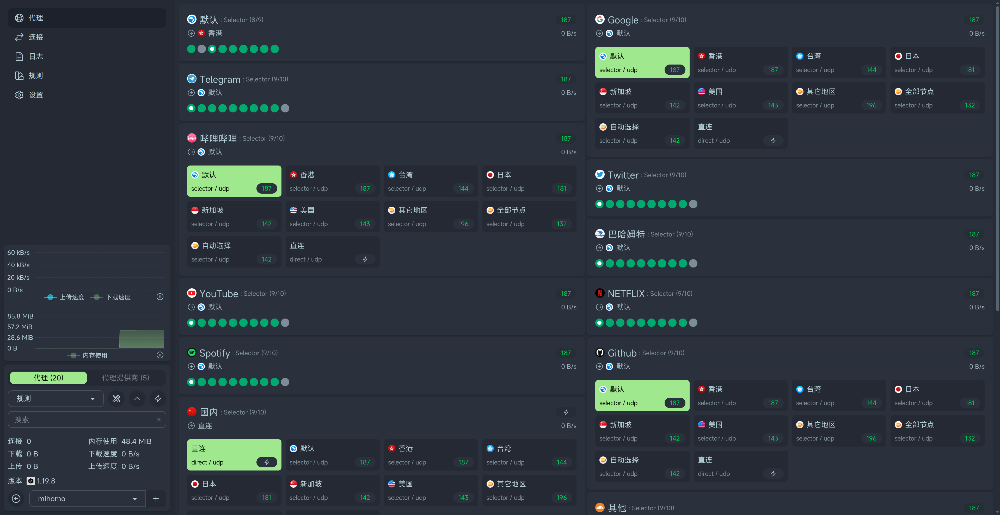
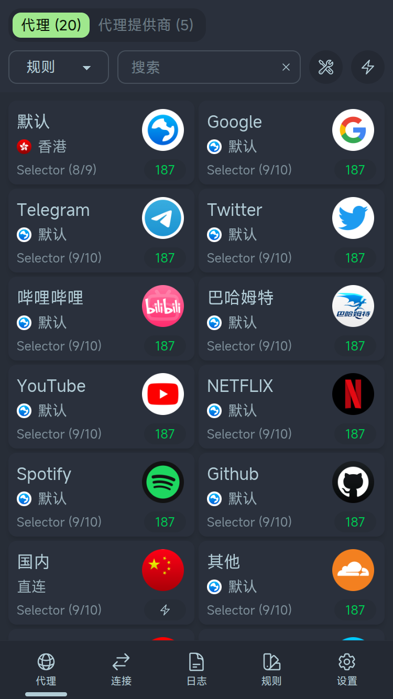

# Форк Zashboard

Этот репозиторий содержит персональный форк [Zashboard](https://github.com/Zephyruso/zashboard) — веб-панели для Clash-совместимых ядер. В форке добавлены индикаторы весов узлов в Smart-группах и проверка обновлений в репозитории форка.

<p align="center">
  
  
</p>

## Требования к браузеру

- Chrome 111 или новее
- Firefox 128 или новее
- Safari 16.4 или новее
- Взломанная версия iOS 16.4 не поддерживается

## Загрузка и установка

Скачайте `dist.zip` со [страницы релизов форка](https://github.com/Desonator/zashboard-fork/releases). Распакуйте архив и разместите содержимое каталога `dist` как внешнюю UI-панель Clash-совместимого ядра. Архив собирается GitHub Actions; архивы с исходным кодом не предназначены для установки в качестве панели.

Чтобы ядро загружало этот форк при обновлении UI, укажите в его конфигурации ссылку на архив релиза этого репозитория. Например:

```yaml
external-ui: ui
external-ui-url: https://github.com/Desonator/zashboard-fork/releases/latest/download/dist.zip
```

Панель проверяет наличие новых релизов именно в этом форке. При обновлении через API ядро скачивает архив по адресу из `external-ui-url`; адрес проверки обновлений панели на эту настройку ядра не влияет. Для отображения статистики Smart-групп используйте ядро, которое поддерживает соответствующие Smart API и возвращает данные о весах.

## Сборка из исходного кода

Требуются Node.js 22 и pnpm.

```sh
pnpm install --frozen-lockfile
pnpm run build
```

Готовые файлы появятся в `dist/`. При отправке изменений в ветку `main` GitHub Actions собирает артефакт. Отправка тега `v*` запускает сборку GitHub Release с архивом `dist.zip`. Состояние сборок и артефакты доступны во вкладке [Actions](https://github.com/Desonator/zashboard-fork/actions).

## Советы

1. Таблицу подключений можно перетаскивать левой кнопкой мыши. Щёлкните правой кнопкой по ячейке, чтобы скопировать её содержимое.
2. Щёлкните правой кнопкой по карточке прокси или группы прокси, чтобы запустить тест скорости.
3. Группы прокси сортируются по порядку узлов в группе `GLOBAL`, который определяется конфигурацией. Чтобы задать свой порядок, настройте группу `GLOBAL`.
4. Панель поддерживает установку в формате PWA через функцию браузера «Добавить на главный экран».
5. Данные о весах Smart-групп панель получает через API подключённого ядра. Они отображаются, только если ядро реализует Smart API форка и возвращает статистику весов.

## Параметры URL

Пример:

```text
http://host:port/#/setup?hostname=ipordomain&port=9090&secret=123456
```

- `protocol`: протокол `http` или `https`; по умолчанию используется протокол текущей страницы. Старые флаги `http=1` и `https=1` также поддерживаются, но приоритет у параметра `protocol`.
- `hostname`: IP-адрес или доменное имя Clash API.
- `port`: порт Clash API.
- `secondaryPath`: необязательный путь, добавляемый к базовому URL; по умолчанию пустой.
- `secret`: пароль для аутентификации в API.
- `disableUpgradeCore=1`: скрывает кнопку обновления ядра.
- `disableTunMode=1`: скрывает переключатель TUN.

### Автоматическое подключение к ядру

Если сохранённых подключений нет и параметр `hostname` не указан, панель пробует подключиться к Clash API по адресу открытой страницы. К этому подключению также применяются параметры URL `secret`, `label`, `type`, `disableUpgradeCore` и `disableTunMode`. Параметры `protocol` и `port` не меняют автоматически определённый адрес.

Например, для такой конфигурации на сервере `192.168.1.1`:

```yaml
external-ui: ui
external-ui-url: https://github.com/Desonator/zashboard-fork/releases/latest/download/dist.zip
external-controller: 0.0.0.0:9090
secret: ''
```

При открытии `http://192.168.1.1:9090/ui` панель попробует подключиться к `http://192.168.1.1:9090` и сохранит подключение, если API ответит. Если для API требуется пароль, передайте его в URL, например `http://192.168.1.1:9090/ui?secret=ваш-пароль`.

В качестве запасного варианта панель также проверяет `http://127.0.0.1:9090` с пустым паролем. Адрес текущей страницы имеет приоритет. Если ядро отклонит пароль, найденный адрес останется в форме — введите пароль вручную. Если ни один адрес не отвечает, форма предложит `http://127.0.0.1:9090` для ручной настройки. Редактирование или отправка формы отменяет автоматическое обнаружение. Сохранённые подключения и явно заданные в URL параметры продолжают работать как раньше.

### Поддержка исходного проекта

Форк основан на [Zephyruso/Zashboard](https://github.com/Zephyruso/zashboard). Если хотите сделать пожертвование, рассмотрите возможность поддержать [UNICEF](https://www.unicef.org/).
