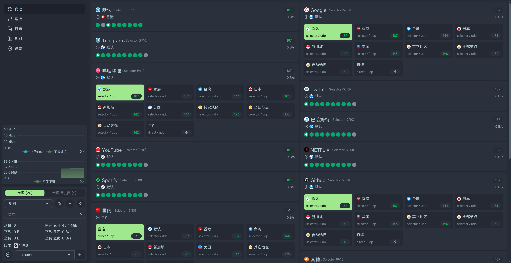
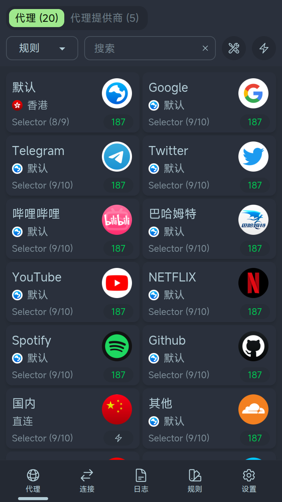

# Zashboard Fork

[Русская версия](./README.md) · [Releases](https://github.com/Desonator/zashboard-fork/releases) · [Builds](https://github.com/Desonator/zashboard-fork/actions)

Zashboard is a web dashboard for managing proxies and monitoring a network core through its API. This repository is a fork of [Zephyruso/Zashboard](https://github.com/Zephyruso/zashboard), with additional Smart-group features and its own release channel.

<p align="center">
  
  
</p>

## Zashboard features

- Browse and select proxies, manage groups and providers.
- Test node and group latency, view measurement history, and filter by availability.
- Monitor connections, traffic, and runtime statistics; inspect logs and routing rules.
- Save multiple backend connections and customize themes, fonts, and CSS; install the dashboard as a PWA.
- Works with Mihomo and Clash API-compatible cores; the DAE API is also supported. Specific features depend on the connected core's API.

## Features added by this fork

### Smart groups

When the core reports groups with `type: smart` and exposes Smart weights, the dashboard can show:

- a single-line status row with the node count, weights, and latency; on narrow screens it scrolls horizontally, and on desktop it can be dragged with the mouse;
- weight and usage rank on node cards;
- a local history of Smart-weight changes in a tooltip;
- the three highest-weight nodes in a group's chain;
- sorting of Smart-group nodes by usage frequency.

Each Smart-specific feature is shown only when Smart groups are present in API data. On official Mihomo without Smart groups, the related settings and indicators are hidden while ordinary proxy groups remain available. The final-outbound setting is generic and can be used without Smart. The three highest-weight nodes are Smart candidates, not a guaranteed route for an individual connection.

Weight history is stored locally in the browser and kept separately for each backend. The dashboard records changes only and does not add network polling for this history.

### Latency and nested groups

- While the proxies page is open and the browser tab is visible, proxy data is refreshed every 10 seconds. Data is refreshed when returning to the tab as well.
- If a group has no history for its own test URL, latency can be resolved from the active nested proxy chain.
- The latency tooltip shows measurement history. A `ping-config` data-transfer status is shown when the core returns the corresponding profile and result.
- Proxy cards have a medium size option in addition to small and large.

### Periodic checks in Prizrak-Core

In Prizrak-Core, `interval` sets the check period, but `lazy` defaults to `true`: background checks are skipped while a group is not selected, so its history does not grow. Set `lazy: false` on the group if you want its history to update even when it is not selected. This also applies to the additional `ping-config` checks.

```yaml
- name: "Primary"
  type: fallback
  url: https://captive.apple.com/generate_204
  interval: 60
  lazy: false
```

See the [Prizrak-Core proxy-group fields](https://core.prizrak.app/config/proxy-groups/) documentation for details.

### Fork updates

The dashboard checks releases from `Desonator/zashboard-fork`. To let the core download updates to this panel, set its `external-ui-url` to an archive from this fork:

```yaml
external-ui: ./ui
external-ui-url: https://github.com/Desonator/zashboard-fork/releases/latest/download/dist.zip
```

The dashboard's update check and the core's `external-ui-url` are separate settings: the first selects the repository used for update notifications, and the second tells the core where to download the panel files.

## Installation

1. Download `dist.zip` from the [Releases page](https://github.com/Desonator/zashboard-fork/releases).
2. Extract it and serve the `dist` directory as the external UI for your core or web server.
3. Connect to the core API. If the dashboard is served from the API's origin and no backend is saved yet, Zashboard tries to connect automatically. Otherwise, enter the API address and secret on the setup page.

`dist.zip` contains the ready-to-serve dashboard. GitHub's `Source code` archives contain source files and are not installable UI packages.

### Build from source

Requirements: Node.js 22 and pnpm.

```sh
pnpm install --frozen-lockfile
pnpm build
```

The production site is written to `dist/`. To build and run a local container:

```sh
docker build -t zashboard-fork .
docker run --rm -p 8080:80 zashboard-fork
```

GitHub Actions builds the project on pushes to `main`. Pushing a version tag such as `vX.Y.Z` builds and publishes a GitHub Release with `dist.zip`.

## Browsers

- Chrome 111+
- Firefox 128+
- Safari 16.4+
- Jailbroken iOS 16.4 is not supported.

## Connect through URL parameters

Basic format:

```text
http://host:port/#/setup?hostname=192.168.1.1&port=9090&secret=...
```

Supported parameters include `protocol`, `hostname`, `port`, `secondaryPath`, `secret`, `label`, `type=dae`, `disableUpgradeCore=1`, and `disableTunMode=1`. The values `disableUpgradeCore=core` and `disableTunMode=tun` also hide those controls. Parameters can be placed in the page's query string or after `?` in the URL fragment; if repeated, the fragment value takes precedence. The secret is sent in clear text as part of the URL; use this only in an appropriate environment and never publish a URL containing a real secret.

If no backend has been saved and `hostname` is omitted, the dashboard probes the current page's origin. It also tries `http://127.0.0.1:9090` as a fallback. When authentication is rejected, the address remains in the form so you can enter the secret manually.

## Developer checks

See [`test/README.md`](./test/README.md) for load, browser, and regression scenarios. Common commands:

```sh
pnpm build
pnpm test:bench
pnpm test:verify
pnpm test:setup
node test/collapse.mjs
```

## Upstream and license

This fork is based on [Zephyruso/Zashboard](https://github.com/Zephyruso/zashboard). The project is licensed under [MIT](./LICENSE). For fork-specific issues, use the [repository issue tracker](https://github.com/Desonator/zashboard-fork/issues).
